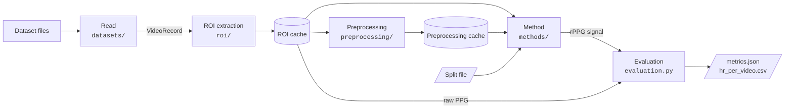

# How rppgkit works

## The pipeline

We process each recording in a fixed sequence of stages, from the raw dataset files to
error metrics. Each stage is implemented as library code in `src/rppgkit/`; the scripts
in `scripts/` read the configuration and run the stages.



| Stage | Run by | Code | Reads | Produces |
|---|---|---|---|---|
| Read | `1_extract_roi.py` | `datasets/` | the video and PPG files of the dataset | a `VideoRecord` in memory |
| ROI extraction | `1_extract_roi.py` | `roi/` | a `VideoRecord` | the ROI cache |
| Preprocessing | `2_preprocess.py` | `preprocessing/` | the ROI cache | the preprocessing cache |
| Split | `3_make_splits.py` | `splits.py` | the subject list of the dataset | a split file in `splits/` |
| Method | `evaluate.py` | `methods/` | cached arrays, the split file | an rPPG signal per test recording |
| Evaluation | `evaluate.py` | `evaluation.py`, `signal_processing.py`, `metrics.py` | the rPPG signal and the raw PPG | heart rates and metrics |

In the read stage, a dataset reader lists the recordings on disk and loads them one at
a time. There is one reader per dataset, e.g. `UBFCrPPGReader` for UBFC-rPPG
([Bobbia et al., 2019](reference/references.md#bobbia2019)). The reader decodes the
video to RGB frames and resamples the ground-truth PPG to one sample per frame. It
performs no cropping, resizing, normalisation or filtering.

The region of interest (ROI) is the part of each frame that a method reads. Each kind
of ROI has its own folder under `roi/`; at present, only the face is implemented
(`roi/face/`). `FaceCropper` applies a face detector to the frames, either a Haar
cascade ([Viola and Jones, 2001](reference/references.md#viola2001)) or YOLO5Face
([Qi et al., 2021](reference/references.md#qi2021)), each in its own folder under
`roi/face/`. It then cuts a box around the face in every frame and resizes it to a
fixed size, e.g. 72 × 72 pixels. The number of frames is unchanged, so the ROI video
remains aligned with the PPG. The result is written to the ROI cache.

A preprocessing step transforms a complete ROI video and its PPG into named arrays
with one row per frame; for example, `Standardize` produces `frames_standardized` and
`ppg_standardized`. Trainable methods read these arrays repeatedly, so
`2_preprocess.py` writes them to the preprocessing cache. Methods without training
apply their preprocessing step during prediction; POS, for example, computes the mean
face colour directly from the ROI cache.

A split file lists, for each fold, the subjects used for training, validation and
testing. We create it once per dataset and split kind (`kfold`, `test_only`);
thereafter it is only read.

A method declares the arrays it requires (`needs`) and transforms one complete test
recording into an rPPG signal. Methods without training, such as POS, are run by
`evaluate.py`. Support for trainable methods (PhysNet,
[Yu et al., 2019](reference/references.md#yu2019)) is in development.

In the evaluation stage, the predicted rPPG signal and the raw PPG from the ROI cache
undergo identical post-processing (detrending, band-pass filtering, spectral peak
detection), which yields one heart rate per signal for each recording or time window.
The errors between the two heart rates are summarised in `metrics.json`; the heart
rates per recording are written to `hr_per_video.csv`.

## Recordings and the data they carry

Each recording is identified by a `RecordingKey` that consists of three parts: the
dataset, the subject and the recording of that subject, e.g.
`RecordingKey("ubfc_rppg", "subject1", "0")`. Its string form, `ubfc_rppg/subject1/0`,
is used in folder names, split files, CSV files and logs. Splits group recordings by
`key.subject_id` (`ubfc_rppg/subject1`), so all recordings of one subject are always
assigned to the same part of a split.

A reader returns a `VideoRecord` with the following fields:

| Field | Content |
|---|---|
| `key` | the `RecordingKey` |
| `frames` | `uint8` RGB video, shape `(T, H, W, 3)` |
| `ppg` | `float32` ground-truth PPG, shape `(T,)`, one sample per frame |
| `fps` | frames per second; sample `i` is at time `i / fps` seconds |
| `meta` | dataset-specific information (e.g. the number of original PPG samples) |

A `VideoRecord` validates these types, shapes and lengths on construction, so a reader
that returns invalid data fails immediately.

Methods never receive a `VideoRecord`. Instead, they receive a `CachedVideo`
(`cached_videos.py`), which contains the key, the frame rate and only those cached
arrays that are listed in the `needs` of the method, read from the ROI and
preprocessing caches.

## Caches and keys

### Layout

We store every cache in a folder under `cache_root`, which is set in
`configs/paths.yaml`:

```
<cache_root>/<dataset>/<stage>/<key>/
├── config.json              the configuration hashed into the key, and the class versions
└── <subject>/<recording>/   one folder per recording
    ├── <name>.npy           one file per array, e.g. frames.npy, ppg.npy, boxes.npy
    └── meta.json            fps, IDs and stage-specific details
```

`<stage>` is either `roi` or `preprocessing`. Arrays are read with memory mapping, so
a script loads only the parts of a file that it uses.

### Keys

`<key>` is a 12-character hash computed from:

- the configuration of the stage, excluding settings that do not affect the output
  (`root`, `device`, `batch_size`, `num_workers`), and
- the `version` number of every class named by a `_target_` in that configuration.

The ROI key is computed from the `dataset` and `roi` configurations. The preprocessing
key is computed from the ROI key and the `preprocessing` configuration; a different ROI
cache therefore always yields a different preprocessing cache.

This scheme has four consequences:

- A changed setting, e.g. `roi.output_size=128`, yields a new key and a new cache
  folder alongside the existing one. Both remain on disk.
- A code change that alters the output of a class requires an increment of its
  `version` number, which also yields a new key.
- Subsequent scripts locate a cache by computing the same key from their own
  configuration. They must therefore be run with the same `dataset`, `roi` and
  `preprocessing` settings as the script that built the cache; otherwise they stop
  with "cache not found" and name the script to run.
- Before any processing begins, each script verifies that every cache contains all the
  recordings it will read. A cache left incomplete by an interrupted build therefore
  stops a script immediately rather than after its work.

### Writing

Each recording folder is written under a temporary name and renamed on completion, so
an existing recording folder is always complete. A build script processes only the
recordings that are not yet in the cache, so an interrupted build can be resumed with
the same command. With `overwrite=true`, all recordings are rebuilt.

### Access from code

A `StageCache` (`cache.py`) represents one cache folder: its stage, its key, its folder
and the configuration from which the key is computed. We always construct it from the
run configuration, never by hand, so that every script computes the same key from the
same settings:

- `StageCache.for_roi(cfg)` returns the ROI cache. Its key is computed from the
  `dataset` and `roi` configurations.
- `StageCache.for_preprocessing(cfg, step_name, roi)` returns the cache of one
  preprocessing step. Its key is computed from the key of the ROI cache `roi` and the
  configuration of that step. The ROI cache is passed as an argument because a
  preprocessing cache is defined only relative to the ROI cache from which it was
  built.
- `preprocessing_caches(cfg, roi)` returns the cache of every step listed in
  `preprocessing`, by step name.

Constructing a `StageCache` neither reads from nor writes to disk, so the cache need
not exist yet. The scripts use the caches as follows:

| Script | Writes | Reads |
|---|---|---|
| `1_extract_roi.py` | the ROI cache | |
| `2_preprocess.py` | one cache per preprocessing step | the ROI cache |
| `evaluate.py` | | the ROI cache and every preprocessing cache |

A script that writes a cache first calls `write_config`, which creates the folder and
its `config.json`. It then calls `write_recording` for each recording returned by
`recordings_not_in_cache`, or for every recording if `overwrite=true`. A script that
reads a cache first calls `check_has_recordings` with every recording it will read;
this call stops immediately if the cache or any recording is missing and names the
script to run. The script then calls `read_recording`, which returns the arrays of the
recording by name together with its `meta.json`. The complete interface is documented
in the [`rppgkit.cache` reference](reference/cache.md).

## Splits and test labels

### Subject-level folds

A split assigns subjects, not recordings, to training, validation and testing, so that
all recordings of a subject fall into the same part. A split file
(`splits/<dataset>_<kind>.json`) lists the subject IDs of each part for every fold,
together with the parameters used to create it: the splitter configuration (`maker`,
whose `_target_` names the splitter class), `include` and `exclude`, the datasets and
the number of subjects. `3_make_splits.py` creates the file once and never overwrites
it; experiments only read it and select a fold with `split.fold`.

A splitter (`splits.py`) partitions a list of subject IDs into folds:

| Kind | Splitter | Folds |
|---|---|---|
| `kfold` | `KFold` | `n_folds` folds; each subject is in the test part of exactly one fold. The validation subjects of each fold are drawn from its training subjects. |
| `test_only` | `TestOnly` | one fold with all subjects in the test part, for methods without training. |

The subject list can be restricted before splitting with `include` and `exclude` in
the split configuration.

### Leakage check

A `Split` cannot be constructed if a subject occurs twice or in more than one part.
This is checked both when the split file is created and each time a fold is loaded.

### Hidden test labels

Arrays whose names begin with `ppg` (the raw PPG and label outputs such as
`ppg_standardized`) are labels. When we load the test recordings for a method, all
label arrays are removed (`cached_videos.py`), so a method receives only video-derived
arrays of the test recordings. The ground truth for evaluation is read separately,
directly from the ROI cache.

## Methods

A method (`methods/method.py`) consists of three parts:

- `needs`: the names of the cached arrays it reads, e.g. `("frames",)`.
- `version`: a number that is incremented whenever the output of the method changes.
- `predict(video)`: transforms one complete test recording (a `CachedVideo`) into
  `{"rppg": signal}`, a one-dimensional signal aligned to the first frame with at most
  as many samples as the recording has frames.

For each test recording of the fold, `evaluate.py` loads the arrays listed in `needs`,
calls `predict` and passes the resulting signal to evaluation. Internal details such as
windows, chunks and models are encapsulated in the method.

POS (`methods/pos.py`, [Wang et al., 2017](reference/references.md#wang2017)) requires
only the face frames. It computes the mean face colour per frame with the `RGBMean`
preprocessing step, slides a window of `window_sec` seconds over the colour signal,
projects each window onto a plane orthogonal to the skin tone and adds the windows
into one pulse signal. POS performs no detrending or filtering; both are part of
evaluation.

## Evaluation

Evaluation (`evaluation.py`) compares each predicted rPPG signal with the ground-truth
PPG of the same recording. The ground truth is the raw PPG from the ROI cache,
truncated to the length of the prediction. Both signals then undergo the same steps,
configured in `configs/evaluation/default.yaml`:

1. By default, each recording is processed as one segment. If `window_sec` is set, the
   recording is divided into windows of that length, starting every
   `window_stride_sec` seconds, and each window is processed independently.
2. Detrending removes slow drifts (smoothness-priors detrending,
   [Tarvainen et al., 2002](reference/references.md#tarvainen2002); regularisation
   parameter `detrend_lambda`).
3. A zero-phase Butterworth band-pass filter of order `filter_order` retains the
   frequencies between `low_hz` and `high_hz`.
4. The heart rate is the frequency of the highest spectral peak within the search band
   (by default, the filter band), multiplied by 60. The spectrum is the periodogram of
   the whole segment or, with `hr_estimator: welch`, the average over shorter segments
   ([Welch, 1967](reference/references.md#welch1967)). `min_fft_length` zero-pads the
   signal to obtain a finer frequency grid.

A signal that is constant or contains non-finite values yields no heart rate (NaN).

### Metrics

From the pairs of predicted and true heart rates for which both exist, `metrics.py`
computes the mean absolute error (`mae_bpm`), the root mean squared error
(`rmse_bpm`), the mean absolute percentage error (`mape_percent`) and the Pearson
correlation coefficient (`pearson_r`). `n_videos` is the number of recordings used
and, with windowing, `n_windows` the number of windows. Segments without a heart rate
are excluded and counted separately: `n_failed_predictions` for the prediction and
`n_failed_ground_truths` for the ground truth.

### Output

Each run writes two files to its run folder: `hr_per_video.csv`, with the predicted
and true heart rate per recording (or per window), and `metrics.json`, with the
metrics and their provenance: the cache keys, the split file and fold, the method and
evaluation settings, and an `experiment_key`. The `experiment_key` is identical for all
folds of one experiment and changes with any other setting, so the folds of an
experiment can be grouped by it.

## Configuration

We configure rppgkit with [Hydra](https://hydra.cc/docs/intro/)
([Yadan, 2019](reference/references.md#yadan2019)). Every setting is defined in a YAML
file under `configs/`, together with a comment that describes it.

### One top-level file per script

Each script has a configuration file of the same name; e.g. `scripts/evaluate.py`
uses `configs/evaluate.yaml`. Its `defaults` list selects one file from each config
group. Settings that concern only that script, such as `overwrite` for the build
scripts, are defined in the top-level file itself:

```yaml
defaults:
  - paths                     # configs/paths.yaml
  - dataset: ubfc_rppg        # configs/dataset/ubfc_rppg.yaml
  - roi: yolo5face36_tight    # configs/roi/yolo5face36_tight.yaml
  - split: test_only          # configs/split/test_only.yaml
  - method: pos               # configs/method/pos.yaml
  - evaluation: default       # configs/evaluation/default.yaml
```

A config group is a folder (`configs/roi/`, `configs/method/`, ...); each file in it
is one option, e.g. `roi/haar72.yaml` and `roi/yolo5face72.yaml`.

### Command-line overrides

Arguments after the script name override the configuration for a single run without
modifying any file:

- `roi=yolo5face72` selects another file of a group.
- `roi.output_size=128` changes a single value.
- `-m` submits the script as a SLURM job, or as one job per value for a sweep such as
  `split.fold=0,1,2,3,4`, with the resources defined in `configs/hydra/launcher/`.

### From YAML to objects

A `_target_` entry names the Python class that a section describes; the script
instantiates that class with the remaining keys of the section as arguments. For
example, `configs/method/pos.yaml` contains `_target_: rppgkit.methods.pos.POS` and
`window_sec: 1.6`, which results in `POS(window_sec=1.6)`. Because the YAML files list
every setting with its value, the values in use can be read directly from them.

### Separation of library and configuration

The code in `src/rppgkit/` never reads configuration files; the scripts instantiate
the objects and pass them plain values. The library can therefore also be used from a
notebook or another script.

### Run folders

Each run has its own folder, `outputs/<date>/<time>/` (with `-m`:
`multirun/<date>/<time>/<n>/`), which contains the script log, the complete
configuration used (`.hydra/config.yaml`) and the results. Caches are written not to
this folder but under `cache_root` (see [Caches and keys](#caches-and-keys)).
